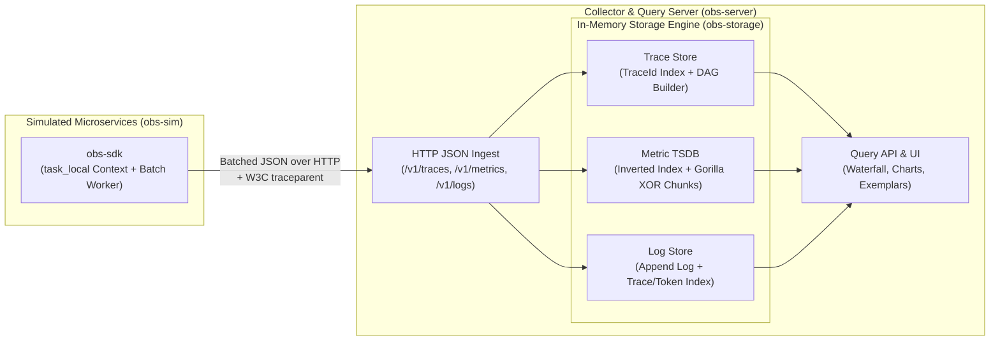

# `mini-obs`: Building an Observability Engine from Scratch in Rust

Welcome to `mini-obs`! This project is a hands-on, from-scratch implementation of a unified observability stack (**Traces, Metrics, and Logs**) built in Rust.

Our goal is twofold:
1. **Master Observability Internals**: Understand how systems like OpenTelemetry, Prometheus, Jaeger, and Datadog actually work under the hood—context propagation, non-blocking ingestion, inverted indexes, Gorilla time-series compression, and exemplar correlation.
2. **Learn Idiomatic Systems Rust**: Practice workspace architecture, `serde` zero-copy/custom serialization, `tokio` async primitives (`task_local!`, `mpsc` channels, `RwLock`), bitwise operations, and `axum` web servers.

---

## Architecture Overview



### Cargo Workspace Layout

```text
/Users/cguerrero/Code/learnings/mini-obs/
├── Cargo.toml             # Workspace root & shared dependencies
├── README.md              # Project roadmap & learning guide (this file)
└── crates/
    ├── obs-proto/         # Wire types: TraceId, SpanId, Span, MetricSample, LogRecord, Exemplar
    ├── obs-sdk/           # Client library: W3C traceparent, tokio::task_local!, async batch exporter
    ├── obs-storage/       # Core engines: Trace DAG assembly, Inverted Index, Gorilla bitstream TSDB
    ├── obs-server/        # Axum ingestion/query server + embedded Web UI (Waterfall & Charts)
    └── obs-sim/           # Simulated microservices generating realistic traffic, errors, and spikes
```

---

## Step-by-Step Curriculum & Roadmap

We will build this iteratively in **5 Phases**, ensuring each phase compiles, has unit tests, and teaches both an **Observability Concept** and a **Rust Concept**.

### Phase 1: The Wire Protocol & Distributed Tracing Core (`obs-proto` + `obs-sdk`)
- **Observability Concepts**:
  - What is a `Trace` vs. a `Span`? Parent-child causal relationships.
  - **W3C Trace Context specification**: Parsing and formatting `traceparent: 00-<16-byte-trace-id>-<8-byte-span-id>-<flags>`.
  - **Context Propagation**: How a trace ID travels across function calls, async tasks, and HTTP boundaries without polluting every function signature.
  - **Non-blocking Telemetry Export**: Why instrumentation must never block the caller (bounded ring-buffer / channel + background batch flusher with periodic timer and drop metrics).
- **Rust Concepts**:
  - Workspace management & crate boundaries.
  - Newtype pattern (`struct TraceId(pub u128)`, `struct SpanId(pub u64)`) with custom hex `Display`/`FromStr` and `serde`.
  - `tokio::task_local!` for async context propagation and RAII drop guards / async span wrappers.
  - `tokio::sync::mpsc` bounded channels + `tokio::select!` for batching by size *or* timeout.
- **Deliverables**:
  - [ ] Workspace `Cargo.toml` and `crates/obs-proto` data structures.
  - [ ] W3C `traceparent` parser & formatter with unit tests.
  - [ ] `crates/obs-sdk` with `in_span("name", async { ... })` and background HTTP JSON batch exporter.

---

### Phase 2: Trace Ingestion, DAG Assembly & Waterfall UI (`obs-storage` + `obs-server`)
- **Observability Concepts**:
  - Out-of-order span arrival (child spans often finish and arrive before the root span).
  - Reconstructing a **Trace Tree (DAG)** from flat spans, calculating self-time vs. wall-clock duration, and finding the **Critical Path**.
  - **Tail-based vs. Head-based sampling** basics.
- **Rust Concepts**:
  - Thread-safe concurrent state with `Arc<RwLock<...>>` (or sharded maps).
  - Arena/index-based tree building in Rust (avoiding `Rc<RefCell<...>>` cycles).
  - Building an HTTP ingestion & query API with `axum`.
- **Deliverables**:
  - [ ] In-memory `TraceStore` with capacity eviction (ring buffer / max traces).
  - [ ] Tree reconstruction & critical-path calculation algorithm.
  - [ ] `POST /v1/traces` and `GET /api/traces/:trace_id` endpoints in `obs-server`.
  - [ ] Interactive **Trace Waterfall (Gantt view)** in the browser UI.

---

### Phase 3: Time-Series Database (TSDB) & Inverted Index (`obs-storage`)
- **Observability Concepts**:
  - Metric types: **Counters** (monotonic), **Gauges** (point-in-time), and **Histograms** (buckets for latency quantiles like `p50`, `p99`).
  - **The High-Cardinality Problem**: Why `series_id = metric_name + sorted_labels` explodes when someone puts `user_id` in a label.
  - **Inverted Index & Postings Lists**: How Prometheus maps `env="prod"` $\rightarrow$ `[Series 1, Series 4, Series 9]` and intersects sorted lists in $O(N)$ to evaluate `http_requests_total{env="prod", status="500"}`.
  - **Gorilla Compression**: Facebook's algorithm that compresses 16-byte `(timestamp, f64)` points down to ~1.37 bytes using **Delta-of-Delta** timestamps and **XOR** floating-point bit packing.
- **Rust Concepts**:
  - Bitwise manipulation (`u64::to_bits()`, `leading_zeros()`, `trailing_zeros()`, bit shifting) to build a custom `BitWriter` and `BitReader`.
  - Fast slice intersection and BTree/Hash indexing.
- **Deliverables**:
  - [ ] `InvertedIndex` supporting label matchers (`=`, `!=`) via sorted postings intersection.
  - [ ] Custom Gorilla `BitChunk` encoder/decoder with compression ratio benchmarks/tests.
  - [ ] `POST /v1/metrics` and time-series query/aggregation API (`rate`, `sum by`, `histogram_quantile`).

---

### Phase 4: Structured Logs & The "Three Pillars" Correlation (`obs-storage` + `obs-sdk`)
- **Observability Concepts**:
  - **Log Correlation**: Automatically injecting the active `trace_id` and `span_id` from `tokio::task_local!` into every log record emitted inside a span.
  - **Exemplars**: Attaching a `TraceId` sample to a high-latency histogram bucket so an engineer looking at a `p99` latency spike on a metric chart can click a single dot and jump straight to the exact slow trace and its logs.
  - **Tokenized Log Search**: Simple inverted token index for fast full-text log filtering alongside structured attribute filters.
- **Rust Concepts**:
  - Combining multiple storage engines cleanly behind unified query traits/structs.
  - String tokenization and zero-allocation slicing (`&str`) where possible.
- **Deliverables**:
  - [ ] `obs_sdk::info!(...)` macro/helper that auto-attaches current `TraceId` & `SpanId`.
  - [ ] `LogStore` indexed by `TraceId` and message tokens.
  - [ ] `Exemplar` storage on metric series + UI integration (click a metric spike $\rightarrow$ open Trace Waterfall + correlated Logs).

---

### Phase 5: Simulated Microservice Mesh & Chaos Scenarios (`obs-sim`)
- **Observability Concepts**:
  - Observing distributed failure modes in action: **Retry Storms**, **N+1 Database Queries**, **Connection Pool Exhaustion**, and **Cascading Timeouts**.
- **Rust Concepts**:
  - Spawning multi-service topologies in `tokio`, propagating HTTP headers (`traceparent`) across `reqwest` calls, and injecting controllable chaos via an API.
- **Deliverables**:
  - [ ] `obs-sim` binary running a simulated `api-gateway` $\rightarrow$ `auth-service` + `order-service` + `payment-db` mesh.
  - [ ] Chaos toggles in the UI (e.g., "Trigger DB Slowdown", "Inject 5% Payment 500s", "Trigger High-Cardinality Label Leak") so you can watch your observability stack catch and diagnose each problem live!

---

## How We Will Work Together
For each phase:
1. We'll walk through the **core data structures and algorithms** first so the "why" is crystal clear.
2. We'll write clean, well-commented Rust code explaining both the **observability mechanics** and the **Rust idioms**.
3. We'll write unit tests (and small CLI/curl checks) at every step so you can inspect the raw JSON payloads, bitstreams, and index structures yourself.
