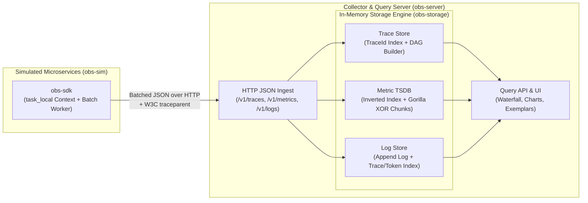

# `mini-obs`: How to Build an Observability Engine in Rust

`mini-obs` is a complete observability system in Rust. This system processes **Traces, Metrics, and Logs**.

This project has two primary objectives:
1. **Understand Observability Systems**: Learn how OpenTelemetry, Prometheus, Jaeger, and Datadog operate. You will build context propagation, non-blocking ingestion, inverted indexes, Gorilla time-series compression, and exemplar correlation.
2. **Write Idiomatic Systems Rust**: Practice workspace architecture, `serde` custom serialization, `tokio` asynchronous primitives (`task_local!`, `mpsc` channels, `RwLock`), bitwise operations, and `axum` web servers.

---

## System Architecture



### Cargo Workspace Structure

```text
/Users/cguerrero/Code/learnings/mini-obs/
├── Cargo.toml             # Workspace root and shared dependencies
├── README.md              # Original project guide
├── README_STE100.md       # Project guide in ASD-STE100 (this file)
└── crates/
    ├── obs-proto/         # Wire types: TraceId, SpanId, Span, MetricSample, LogRecord, Exemplar
    ├── obs-sdk/           # Client library: W3C traceparent, tokio::task_local!, async batch exporter
    ├── obs-storage/       # Core engines: Trace DAG assembly, Inverted Index, Gorilla bitstream TSDB
    ├── obs-server/        # Axum ingestion and query server with embedded Web UI
    └── obs-sim/           # Simulated microservices that generate traffic, errors, and load spikes
```

---

## Project Plan

We will build this system in **5 Phases**. Each phase compiles, includes unit tests, and teaches one **Observability Concept** and one **Rust Concept**.

### Phase 1: Wire Protocol and Distributed Trace Core (`obs-proto` + `obs-sdk`)
- **Observability Concepts**:
  - Define a `Trace` and a `Span`. Identify parent-child relationships between spans.
  - **W3C Trace Context specification**: Parse and format the header `traceparent: 00-<16-byte-trace-id>-<8-byte-span-id>-<flags>`.
  - **Context Propagation**: Send a trace ID across functions, asynchronous tasks, and HTTP requests. Do not add parameters to every function signature.
  - **Non-blocking Telemetry Export**: Ensure that instrumentation does not stop the caller. Use a bounded channel and a background worker to send batches on a timer.
- **Rust Concepts**:
  - Configure Cargo workspaces and crate boundaries.
  - Apply the newtype pattern (`struct TraceId(pub u128)`, `struct SpanId(pub u64)`) with custom hexadecimal `Display`, `FromStr`, and `serde` traits.
  - Use `tokio::task_local!` to propagate asynchronous context. Use drop guards to close spans automatically.
  - Use `tokio::sync::mpsc` bounded channels and `tokio::select!` to send batches by size or by timeout.
- **Deliverables**:
  - [ ] Workspace `Cargo.toml` and `crates/obs-proto` data structures.
  - [ ] W3C `traceparent` parser and formatter with unit tests.
  - [ ] `crates/obs-sdk` with `in_span("name", async { ... })` and a background HTTP JSON batch exporter.

---

### Phase 2: Trace Ingestion, DAG Assembly, and Waterfall UI (`obs-storage` + `obs-server`)
- **Observability Concepts**:
  - Handle spans that arrive out of sequence. Child spans frequently finish and arrive before the root span.
  - Build a **Trace Tree (DAG)** from flat spans. Calculate self-time, total duration, and the **Critical Path**.
  - Compare **Tail-based sampling** and **Head-based sampling**.
- **Rust Concepts**:
  - Manage concurrent state safely across threads with `Arc<RwLock<...>>`.
  - Build index-based trees in Rust. This method prevents `Rc<RefCell<...>>` reference cycles.
  - Build an HTTP ingestion and query API with `axum`.
- **Deliverables**:
  - [ ] In-memory `TraceStore` that removes old traces when full.
  - [ ] Algorithm to build trace trees and calculate the critical path.
  - [ ] `POST /v1/traces` and `GET /api/traces/:trace_id` endpoints in `obs-server`.
  - [ ] Interactive **Trace Waterfall (Gantt view)** in the web browser UI.

---

### Phase 3: Time-Series Database (TSDB) and Inverted Index (`obs-storage`)
- **Observability Concepts**:
  - Define the three metric types: **Counters** (values that only increase), **Gauges** (point-in-time values), and **Histograms** (latency buckets for quantiles such as `p50` and `p99`).
  - **High-Cardinality Problem**: Unique labels such as `user_id` create too many time-series identifiers (`series_id = metric_name + sorted_labels`). This condition consumes excessive memory.
  - **Inverted Index and Postings Lists**: Map labels like `env="prod"` to a sorted list of series IDs (`[Series 1, Series 4, Series 9]`). Intersect these lists in $O(N)$ time to evaluate queries.
  - **Gorilla Compression**: Compress 16-byte `(timestamp, f64)` data points to approximately 1.37 bytes. Use **Delta-of-Delta** timestamps and **XOR** floating-point bit operations.
- **Rust Concepts**:
  - Use bitwise operations (`u64::to_bits()`, `leading_zeros()`, `trailing_zeros()`, and bit shifts) to build a custom `BitWriter` and `BitReader`.
  - Intersect sorted slices quickly and build BTree or Hash indexes.
- **Deliverables**:
  - [ ] `InvertedIndex` that supports label matchers (`=`, `!=`) through sorted list intersection.
  - [ ] Custom Gorilla `BitChunk` encoder and decoder with compression tests.
  - [ ] `POST /v1/metrics` and a time-series query API (`rate`, `sum by`, `histogram_quantile`).

---

### Phase 4: Structured Logs and Data Correlation (`obs-storage` + `obs-sdk`)
- **Observability Concepts**:
  - **Log Correlation**: Read the active `trace_id` and `span_id` from `tokio::task_local!`. Attach these IDs automatically to every log record in a span.
  - **Exemplars**: Attach a `TraceId` sample to a slow histogram bucket. A user can click a latency spike on a metric chart to open the matching trace and logs.
  - **Tokenized Log Search**: Build an inverted token index to filter full-text logs and structured attributes quickly.
- **Rust Concepts**:
  - Connect multiple storage engines through common query traits and structures.
  - Split strings into tokens with string slices (`&str`) to avoid extra memory allocations.
- **Deliverables**:
  - [ ] `obs_sdk::info!(...)` macro that attaches the current `TraceId` and `SpanId` automatically.
  - [ ] `LogStore` with indexes for `TraceId` and message tokens.
  - [ ] `Exemplar` storage on metric series and UI links from metric spikes to the Trace Waterfall and logs.

---

### Phase 5: Simulated Microservice Mesh and Failure Tests (`obs-sim`)
- **Observability Concepts**:
  - Observe common distributed system failures: **Retry Storms**, **N+1 Database Queries**, **Connection Pool Exhaustion**, and **Cascading Timeouts**.
- **Rust Concepts**:
  - Start multiple asynchronous services in `tokio`. Send `traceparent` HTTP headers across `reqwest` calls. Control failure modes through an API.
- **Deliverables**:
  - [ ] `obs-sim` executable that runs a simulated service mesh (`api-gateway` $\rightarrow$ `auth-service` + `order-service` + `payment-db`).
  - [ ] Failure controls in the UI (for example: "Trigger DB Slowdown", "Inject 5% Payment 500s", "Trigger High-Cardinality Label Leak"). Use these controls to detect and find faults in real time.

---

## Work Procedure
Follow these steps for each phase:
1. Review the **core data structures and algorithms** first to understand the design.
2. Write clear Rust code with comments that explain the **observability mechanics** and the **Rust idioms**.
3. Run unit tests and CLI commands at each step to inspect the JSON payloads, bitstreams, and index structures.
